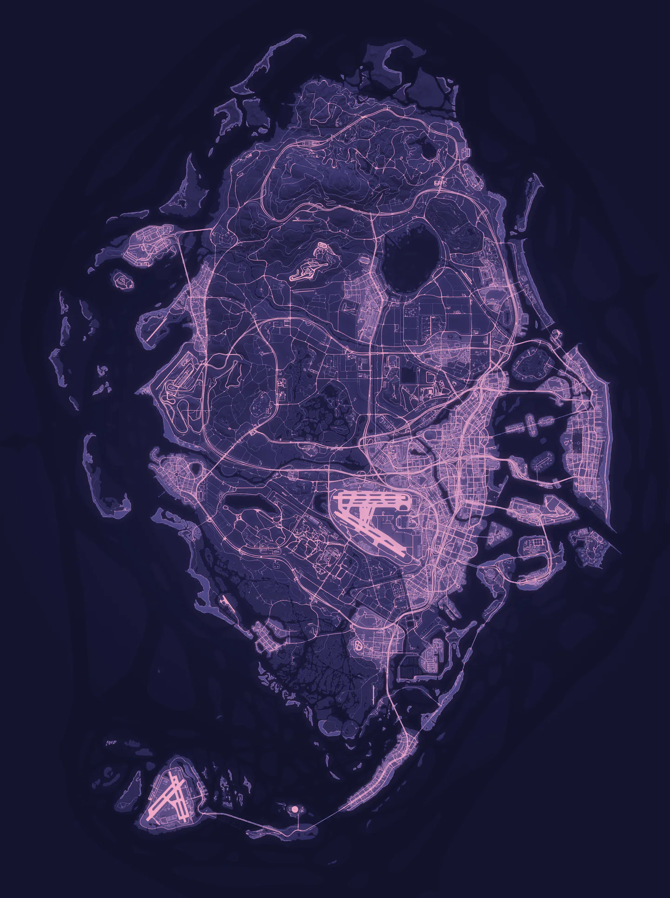

<div align="center">



# VICE ATLAS

### YOUR GRAND THEFT AUTO VI COMPANION

**Explore Leonida. Discover its people. Build your own atlas.**

[](https://pulsebreakpt.github.io/VicePortal/)
[](https://github.com/PulseBreakPT/VicePortal)
[](https://github.com/PulseBreakPT/VicePortal/issues/new)


[Overview](#overview) · [Explore the atlas](#explore-the-atlas) · [Catalogue](#character-catalogue) · [Architecture](#architecture) · [Getting started](#getting-started) · [Contributing](#contributing)

</div>

> **Website:** [pulsebreakpt.github.io/VicePortal/](https://pulsebreakpt.github.io/VicePortal/) — GitHub Pages project landing page. As checked on November 27, 2026, Pages serves the repository documentation; the interactive React application has not been verified as deployed there. Run the application locally using the instructions below.

---

## Overview

Vice Atlas is an independent, English-language fan companion for **Grand Theft Auto VI**. Maintained in the VicePortal repository, it brings the people, places, stories, vehicles and media of Leonida into a single browsable reference.

The experience combines a cinematic presentation with structured editorial dossiers, a searchable directory, and a personal collection of bookmarks and progress. Its visual identity uses a midnight palette, tropical accents, bold typography and restrained animation.

The project is under active development. Catalogue entries distinguish official material, community reporting and editorial interpretation, with explicit notices wherever evidence is incomplete.

## Explore the atlas

| Area | What you can explore |
| :--- | :--- |
| **Leonida** | An illustrated regional map, locations, activities, properties and wildlife |
| **Story & characters** | Protagonists, supporting roles, side contacts, factions, missions and encounters |
| **Garage** | Vehicle categories, documented attributes, customization references and comparisons |
| **Weapons** | Equipment categories, customization references and comparison views |
| **Progress** | Personal atlas checklist, bookmarks, collectible and achievement reference pages |
| **Guides** | Money, controls, cheats, gameplay mechanics and frequently asked questions |
| **Life in Leonida** | Radio, podcasts, television, nightlife and fictional brands |
| **Media & news** | Official trailers, screenshots, artwork, announcements and editorial features |
| **Game information** | Editions, platforms, development, reception and online-mode reference sections |

Some sections are reference indexes awaiting further verified content; a listed page does not mean every item in that category has been documented.

### Built for exploration

- **Searchable directory:** access the search overlay with `Ctrl+K` or `Cmd+K`.
- **Dedicated dossiers:** individual routes, sourced summaries, images, documented attributes and related records.
- **Spoiler controls:** story-sensitive material is protected when spoilers are disabled.
- **Personal atlas:** bookmarks and checklist progress stored in the current browser.
- **Media provenance:** source links and explicit distinctions between portraits, contextual scenes and missing images.
- **Responsive experience:** mobile navigation, accessible focus states and reduced-motion support.

## Character catalogue

**Editorial snapshot — November 27, 2026**

| Metric | Records |
| :--- | ---: |
| Total dossier IDs | **589** |
| Story, encounters and other non-media-credit records | 272 |
| Radio, podcast, television and in-world game dossiers | 317 |
| Official main and full story cast roles | 202 |
| Official media role labels indexed | 328 |
| Character image references | 202 |
| Contextual visuals only | 27 |
| No sourced image | 360 |

These are catalogue records, not necessarily distinct individuals. Media appearances, aliases and legacy cross-references may represent the same character. Image counts describe attributed references, not verified live image loads.

See the [character image and biography audit](docs/character-image-biography-audit.md) for missing portraits, partial biographies and unconfirmed identities.

### Editorial standards

1. Preserve official credited names and stable identifiers.
2. Attach a traceable source to every character record.
3. Distinguish documented appearances from unconfirmed identity matches.
4. Never substitute another character, an earlier game's portrait or a generated likeness for missing GTA VI evidence.
5. Keep scene images and programme artwork separate from character portraits.

## Architecture

| Layer | Technology |
| :--- | :--- |
| Interface | React 19, JavaScript, React Router |
| Styling & components | CSS, Tailwind CSS, Radix UI, Lucide |
| Motion | Framer Motion, Lenis |
| Build tooling | Create React App, CRACO, Yarn Classic |
| Starter API | FastAPI, Pydantic, Uvicorn |
| Starter database integration | MongoDB, Motor |
| Catalogue quality | JavaScript integrity tests and Node-based GitHub Actions validation |

The atlas currently uses bundled catalogue data and browser-local state. The repository also contains a FastAPI/MongoDB starter API; the personal atlas does not require user accounts or cloud synchronization.

```text
VicePortal/
├── frontend/
│   ├── public/images/              # Local artwork and fallback assets
│   ├── scripts/                    # Catalogue verification
│   └── src/
│       ├── components/portal/      # Directory, sections and dossiers
│       ├── data/                   # Catalogues, routes and evidence
│       └── hooks/                  # Search, bookmarks and local progress
├── backend/                        # FastAPI starter service
├── docs/                           # Editorial coverage audits
├── .github/workflows/              # Automated catalogue verification
└── README.md
```

## Getting started

### Requirements

- Git
- Node.js 22 recommended for the catalogue verifier
- Yarn Classic 1.22
- Python and MongoDB only if running the starter API

### Run the frontend

```bash
git clone https://github.com/PulseBreakPT/VicePortal.git
cd VicePortal/frontend
yarn install
yarn start
```

Open [http://localhost:3000](http://localhost:3000).

For a production bundle:

```bash
yarn build
```

The build is written to `frontend/build/`. A production host must support client-side route fallback and the configured public asset base. GitHub Pages currently serves the project landing page, not a verified application build.

### Optional backend

From the repository root:

```bash
cd backend
python -m venv .venv
source .venv/bin/activate
pip install -r requirements.txt
```

Create a local `backend/.env` file:

```dotenv
MONGO_URL=mongodb://localhost:27017
DB_NAME=vice_atlas
CORS_ORIGINS=http://localhost:3000
```

```bash
uvicorn server:app --reload --host 127.0.0.1 --port 8000
```

The existing starter exposes its API under `/api` and interactive API documentation at [http://127.0.0.1:8000/docs](http://127.0.0.1:8000/docs). Never commit credentials or environment files containing secrets.

## Quality & verification

Run the dependency-free catalogue validator from the repository root:

```bash
node frontend/scripts/verify-character-catalogue.mjs
```

To run the frontend test suite after installing dependencies:

```bash
cd frontend
yarn test --watchAll=false
```

The [catalogue workflow](.github/workflows/character-catalogue.yml) is configured to check relevant changes. The latest editorial audit recorded 6,325 assertions across seven data-test bodies in a lightweight assertion harness. That is not equivalent to a verified production build, full Jest execution or browser test.

## Sources & credits

Primary source: [Rockstar Games — Grand Theft Auto VI](https://www.rockstargames.com/VI).

Community reference material includes [GTABase](https://www.gtabase.com/gta-6/), [GTA Wiki](https://gta.wiki/), [GTA Fandom](https://gta.fandom.com/), [GTA6Ops](https://gta6ops.com/), [PowerPyx](https://www.powerpyx.com/) and [GTA6DATA](https://gta6data.com/). Individual dossier source links provide the specific references used.

## Contributing

Corrections, source-backed catalogue additions and accessibility improvements are welcome.

- Open an [issue](https://github.com/PulseBreakPT/VicePortal/issues/new) describing the entry, error and supporting source.
- For data changes, preserve existing IDs, credit names and source distinctions.
- Identify spoilers and label contextual images accurately.
- Run the catalogue verifier before submitting a pull request.

### Development priorities

- Expand verified biographies and replace missing or low-resolution portraits.
- Improve source traceability and remote image reliability.
- Complete and validate remaining catalogue sections.
- Verify the production build and publish the interactive application.

## Disclaimer

Vice Atlas is an unofficial fan project. It is not affiliated with, endorsed by or sponsored by Rockstar Games or Take-Two Interactive. Grand Theft Auto, GTA VI and related trademarks, characters and imagery belong to their respective owners. Third-party material remains subject to its applicable rights and terms. No project-wide software license has been declared in the repository as of this snapshot.

---

<div align="center">

**VICE ATLAS** · Built for the Leonida community

Maintained by [PulseBreakPT](https://github.com/PulseBreakPT)

[Project website](https://pulsebreakpt.github.io/VicePortal/) · [Repository](https://github.com/PulseBreakPT/VicePortal) · [Issues](https://github.com/PulseBreakPT/VicePortal/issues)

</div>
